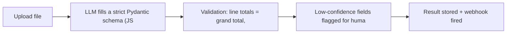

# Invoice - PO & Medical Referral Data Extraction - Report Generation API

> Upload a PDF/image invoice or purchase order and get validated structured JSON (vendor, lines, totals, tax).

 

**Live demo:** https://extract.abmajeed.com
**Category:** Python / FastAPI
**Stack:** FastAPI, Ollama (vision/LLM), pdfplumber, Pydantic, PostgreSQL

---

## Purpose
Automates manual invoice and purchase-order data entry - one of the most common AI automation needs in finance and procurement teams.

## Workflow
1. Upload file → text/OCR extraction
2. LLM fills a strict Pydantic schema (JSON mode)
3. Validation: line totals = grand total, dates, currency
4. Low-confidence fields flagged for human review
5. Result stored + webhook fired



## End output
API + tiny web page: drop a PDF, see extracted JSON and a confidence score per field.

## Project structure
```
app/{main,schemas,extract,validate}.py
samples/  tests/
```

## Quick start
```bash
git clone https://github.com/abdulmajeed3/doc-extract-api.git
cd doc-extract-api
cp .env.example .env      # set DB / LLM endpoint (e.g. OLLAMA_URL)
docker compose up --build
```

## Roadmap (each item ≈ one day of real commits)
- [ ] Upload endpoint
- [ ] PDF text extraction
- [ ] OCR fallback
- [ ] Pydantic invoice schema
- [ ] Ollama structured output
- [ ] Math validation rules
- [ ] Confidence scoring
- [ ] Review queue endpoint
- [ ] Webhook on completion
- [ ] Sample invoices + tests
- [ ] Screenshots / GIF in `docs/`
- [ ] Deploy demo + add link above

## References & credits
| Reference | License | How it's used |
|---|---|---|
| [Pydantic](https://github.com/pydantic/pydantic) | MIT | Schema-first extraction |

If any code is adapted from a referenced project, its copyright notice is kept in `NOTICE` per that license.

## Author
**Abdul Majeed** - Full-stack & AI engineer, [Piytech](https://piytech.com)
Portfolio: [abmajeed.com](https://abmajeed.com) · GitHub: [@abdulmajeed3](https://github.com/abdulmajeed3)

## License
MIT - see `LICENSE`.
